```html
<div align="center">


<br/>

<h1>Abdelrhman Seleem</h1>

### AI Engineer | Machine Learning | Generative AI | Data Science & Analytics

Building intelligent systems through data, machine learning, and modern AI technologies.

<br/>

<a href="https://github.com/Seleem488">
  
</a>
<a href="https://www.linkedin.com/in/abdelrhman-seleem/">
  
</a>
<a href="mailto:abdelrhmanseleem1@gmail.com">
  
</a>
<a href="https://wa.me/201014913652">
  
</a>

<br/>

<!-- BASHABOT_DAILY_MESSAGE_START -->
<div align="center">

  

</div>
<!-- BASHABOT_DAILY_MESSAGE_END -->

<sub>Exploring AI, building intelligent systems, and turning ideas into reality.</sub>

<br/>

</div>

---

## About Me

I'm a Computer and Data Science student specializing in Artificial Intelligence and Deep Tech.

I enjoy working with data, understanding how intelligent systems learn, and exploring how AI can be used to solve real problems.

My journey started with Data Analysis and traditional Machine Learning, where I developed an interest in exploring datasets, discovering patterns, and building predictive models. This gradually led me toward Deep Learning, Computer Vision, Large Language Models, RAG systems, and Agentic AI.

I'm particularly interested in the connection between these fields: how raw data becomes useful information, how models learn from it, and how AI applications can use that knowledge to build more capable systems.

I prefer learning through implementation. I enjoy exploring how things work internally, experimenting with different approaches, and building projects that help me understand the technology beyond its basic usage.

### Areas of Interest

- 🤖 AI Engineering, Machine Learning, and Deep Learning.
- 🧠 Generative AI, LLMs, RAG, and AI Agents.
- 🔗 Agentic Workflows and Multi-Agent Systems.
- 📊 Data Analysis, Statistical Analysis, and Business Intelligence.
- 👁️ Computer Vision and Object Detection.
- ⚙️ End-to-end AI application development.

---

## Training & Professional Development

### DSC Egypt — AI & Deep Tech Internship

**2026 | Currently Participating**

Participating in a practical internship focused on applying AI and Deep Tech concepts to real-world challenges.

Areas of focus:

- Artificial Intelligence and Machine Learning.
- Generative AI and LLM applications.
- Practical AI solutions and collaborative development.
- Project-based learning and technical problem-solving.

### Digital Egypt Pioneers Initiative - Depi — Agentic AI Training

**2026 | Currently Participating**

Developing practical knowledge of Generative AI and autonomous AI systems.

Areas of focus:

- Large Language Models (LLMs).
- Retrieval-Augmented Generation (RAG).
- AI Agents and Agentic Workflows.
- Tool Calling and AI Application Development.
- Multi-Agent Systems.

### Digital Egypt Pioneers Initiative - Depi — Data Analysis Training

**2025 | Completed**

Developed practical data analysis skills through working with datasets and analytical tasks.

Areas covered:

- Data Cleaning and Preprocessing.
- Exploratory Data Analysis.
- Data Visualization.
- Analytical Thinking.
- Extracting insights from data.

---

## Technical Skills

### Artificial Intelligence & Machine Learning

Interested in developing machine learning solutions and understanding the complete modeling process, from data preparation and feature engineering to model training and evaluation.

- Supervised and Unsupervised Learning.
- Classification and Regression.
- Clustering and Feature Engineering.
- Model Evaluation.
- Deep Learning and Neural Networks.
- Computer Vision.
- Object Detection and Tracking.

### Generative AI & Large Language Models

Exploring the engineering behind LLM-powered applications and intelligent systems.

- Large Language Models.
- Prompt Engineering.
- Text Embeddings and Semantic Search.
- Vector Search and Information Retrieval.
- Retrieval-Augmented Generation (RAG).
- LangChain and Hugging Face.
- AI Agents and Tool Calling.
- Agentic Workflows and Multi-Agent Systems.
- AI Memory and Context Management.

### Data Science & Data Analysis

Data analysis remains an important part of my technical background and problem-solving approach.

- Data Collection and Preparation.
- Data Cleaning and Exploratory Data Analysis.
- Statistical Analysis.
- Data Visualization.
- Feature Engineering.
- SQL Analysis.
- Business Intelligence.
- Dashboard Development and Data Storytelling.

### Data Engineering & AI Deployment

- Data Processing and Management.
- Database Fundamentals.
- APIs and Application Integration.
- Docker and Containerization.
- Model Deployment.
- Cloud Technologies.
- AI Application Development.

---

## Tech Stack

<div align="center">

### Programming Languages


### Data Science & Machine Learning


### Generative AI & Development


### Computer Vision & Data Analytics


<br/>


</div>

---

## Selected Projects

### 1. EGX Stock Return Prediction & Investment Recommendation System

**Graduation Project | In Development**

An AI-powered investment decision support system focused on the Egyptian Exchange (EGX).

The project aims to connect financial data analysis and predictive modeling with personalized investment recommendations.

Planned components:

- Historical EGX stock data processing and analysis.
- Stock Return Prediction across different time horizons.
- Stock Recommendation.
- Personalized Investment Suggestions.
- Portfolio Optimization and Capital Allocation.
- Investment Risk Assessment.
- Explainable Investment Insights.

The goal is to move beyond isolated stock prediction and build a system that supports more informed investment decisions.

### 2. Semantic Search & RAG System

A project exploring semantic information retrieval and the use of retrieved context to support LLM-generated responses.

Key concepts:

- Text Embeddings and Vector Representations.
- Semantic Similarity.
- Vector Search.
- Context Retrieval.
- Retrieval-Augmented Generation.

### 3. MediBot — AI Chatbot

A conversational AI application built using Google's Gemini models.

Key concepts:

- Gemini API Integration.
- Prompt Engineering.
- LLM-powered Conversations.
- Conversational Application Development.

### 4. Traffic Detection & Tracking

A Computer Vision project focused on detecting and tracking vehicles in video streams.

The system combines object detection and multi-object tracking to identify vehicles and follow them across video frames.

**Technologies:** YOLOv8 · ByteTrack · OpenCV

### 5. Bank Marketing Analytics

A data analysis project exploring customer behavior and marketing campaign data.

The project focuses on understanding the dataset, investigating customer characteristics, and presenting analytical findings through an interactive application.

Key concepts:

- Data Preprocessing.
- Exploratory Data Analysis.
- Customer Behavior Analysis.
- Data Visualization.
- Interactive Dashboards.

**Technologies:** Python · Pandas · Streamlit

---

## Currently Exploring

I'm currently spending more time on the engineering side of AI, especially the components required to build reliable applications powered by LLMs.

- Advanced RAG Architectures.
- Open-Source LLMs.
- Hugging Face and Model Integration.
- Agentic AI.
- Multi-Agent Architectures.
- AI Memory Systems.
- LLM Evaluation.
- AI Application Deployment.
- Cloud Technologies.
- Data Engineering.

Alongside that, I continue developing my foundations in Machine Learning, Statistics, SQL, and Data Analytics.

---

## GitHub Statistics

<div align="center">


<br/>

### Contribution Activity



</div>

---

## A Little About How I Work

I don't like treating technologies as isolated tools. I prefer understanding how different components fit together and why a particular approach is suitable for a problem.

When working on a project, I try to understand the problem first, explore the available data, experiment with possible solutions, and evaluate the results before deciding what works best.

Sometimes that means going back to the basics, debugging something that should have worked, or trying a completely different approach.

I believe that building projects is one of the best ways to develop a deeper understanding of technology.

---

## Connect With Me

I'm always open to connecting with people interested in AI, Machine Learning, Data Science, and technology.

<div align="center">

<a href="https://github.com/Seleem488">
  
</a>
<a href="https://www.linkedin.com/in/abdelrhman-seleem/">
  
</a>
<a href="mailto:abdelrhmanseleem1@gmail.com">
  
</a>
<a href="https://wa.me/201014913652">
  
</a>

</div>

---

<div align="center">

*Learning through building, exploring through experimentation, and connecting data with intelligent systems.*

</div>
```
